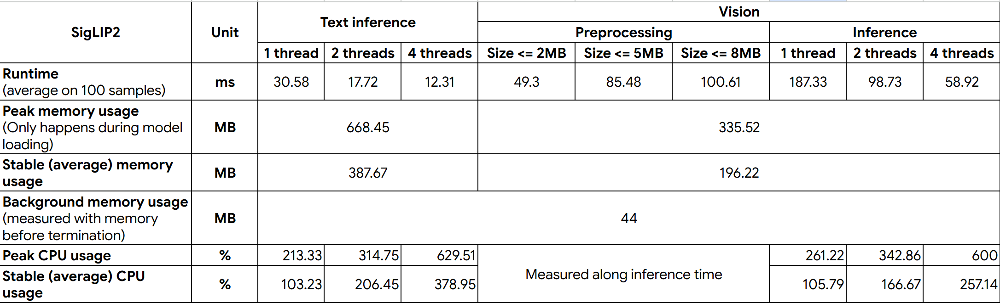

# Opsis gallery's model experiment playground

## 1. Overview

This folder contains model quantization code in Python and model CPU runtime benchmarks in Rust. **The benchmark environment configuration is far from perfect.**

The models and images used for the test will **not** be included in this repository.

## 2. Testing device spec

- **CPU**: Ryzen 9 8945HX
- **RAM**: DDR5 32GB 5200MHz
- **SSD**: 1TB M.2 PCIe NVMe

## 3. Model runtime test

### 3.1. YOLOE-26

YOLOE-26 allows flexible amount of detection classes, but the trade-off in accuracy is risky for fuzzy search.
Notes from runs:

- The model configuration is set as follows:

```python
imgsz=320,
quantize=8,
simplify=True
```

- At nano size (yoloe26n), the model performs not so well both prompt-free and with custom classes: classes are mostly either gibberish or not unique across images. It gets only relatively useful from the small size onward.
- Runtime is tested on a folder of 1000 images whose size is from 2.7 - 14.8 MB. The average, median, and standard deviation of processing time, from pre- to post-processing, is ~180ms, ~160ms, and ~100ms respectively.
- Setup on both Python and Rust in 2 different approaches (using the native Ultralytics library and using ONNX Runtime execution engine) differ inconsiderably in runtime (hence the setup in Rust still using `ultralytics-inference` library).
- The benchmark suggests that the total processing time pre- and post-inference is longer than the inference time itself: inference time revolves around 30ms, while total processing time stretches up to 180ms, as report has shown.

### 3.2. PaddleOCR V4

This may be caused by wrong setup or incompatible ONNX files since PaddleOCR has too many distinct versions for various languages, but detection yields nothing across 1000 images
The detection time revolves around 63ms. The total processing time should be less than 100ms.

### 3.3. SigLIP2

SigLIP2, although significantly heavier, is the ultimate fallback when object detection + OCR + fuzzy search does not perform well.

The following configuration is set for SigLIP2:

- Its variant is `siglip2-base-patch16-244`. The quantized ONNX model is taken from [the ONNX community](https://huggingface.co/onnx-community/siglip2-base-patch16-224-ONNX).
- The current model is quantized to INT8, and 2 parts of the model (`text` and `vision`) are separated.
- Only `ort` and `tokenizer` crates are used to deal with model loading and running. Any other modules from HuggingFace or the likes are not included in the run.

Specific benchmark configuration:

- The benchmark aims at measuring CPU usage (%), RAM usage (MB), and runtime (ms). Their tests are separated into 2 files:

  - `main.rs`: measures resource usage.
  - `benches/bench.rs`: measures runtime.
  - Both of them has adjustable intra-thread count argument for ONNX.

- It runs on full-release mode (fully optimized).
- The testing dataset contains 1000 images whose size range from 2.7MB to 14.8MB.

The table below records measurement results:



- Across different numbers of threads, the records of memory usage remains intact.
- Peak memory only occurs during model load because ONNX allocates memory to load the graph-optimized model optimally.
- The reason for textual inference outnumbers visual inference in memory usage is due to the fact that it needs a tokenizer.
- The percentage in CPU usage measurement means the number of cores used during processing.
- Only the runtime is set to run on 100 samples because the default number of iterations of `benches/bench.rs` is used.
- Any image whose size above 8MB is considered outliers in the test.

Based on the test:

- It is safe to set a fixed thread count of 2 for model inference.
- Its runtime is eventually suitable if the album contains ~10000 images (which takes ~30 minutes to fully process)
- There should be only 1 active module of the model at a time (eg. if image processing for search is forthcoming, unload the textual encoder and load only the visual encoder).
